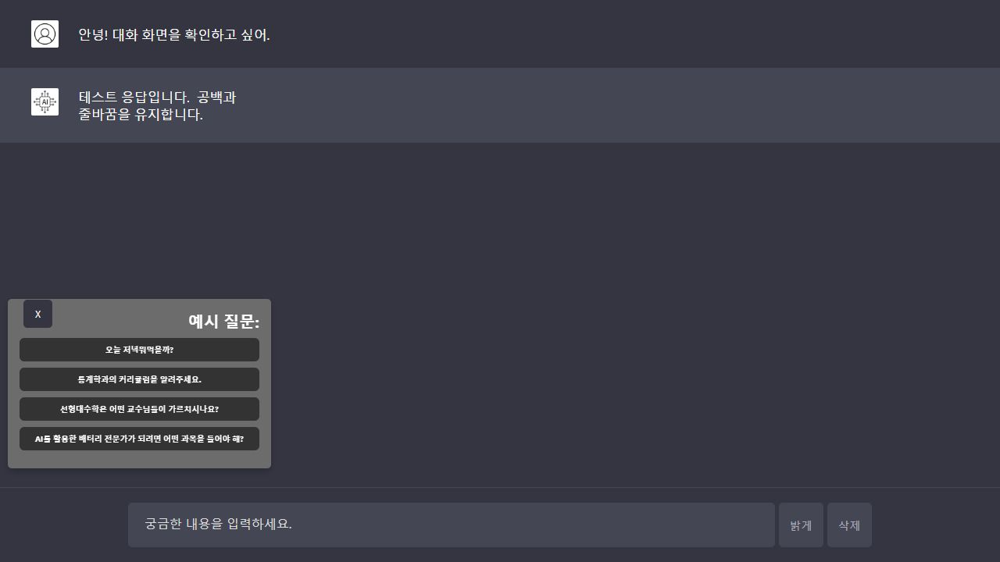
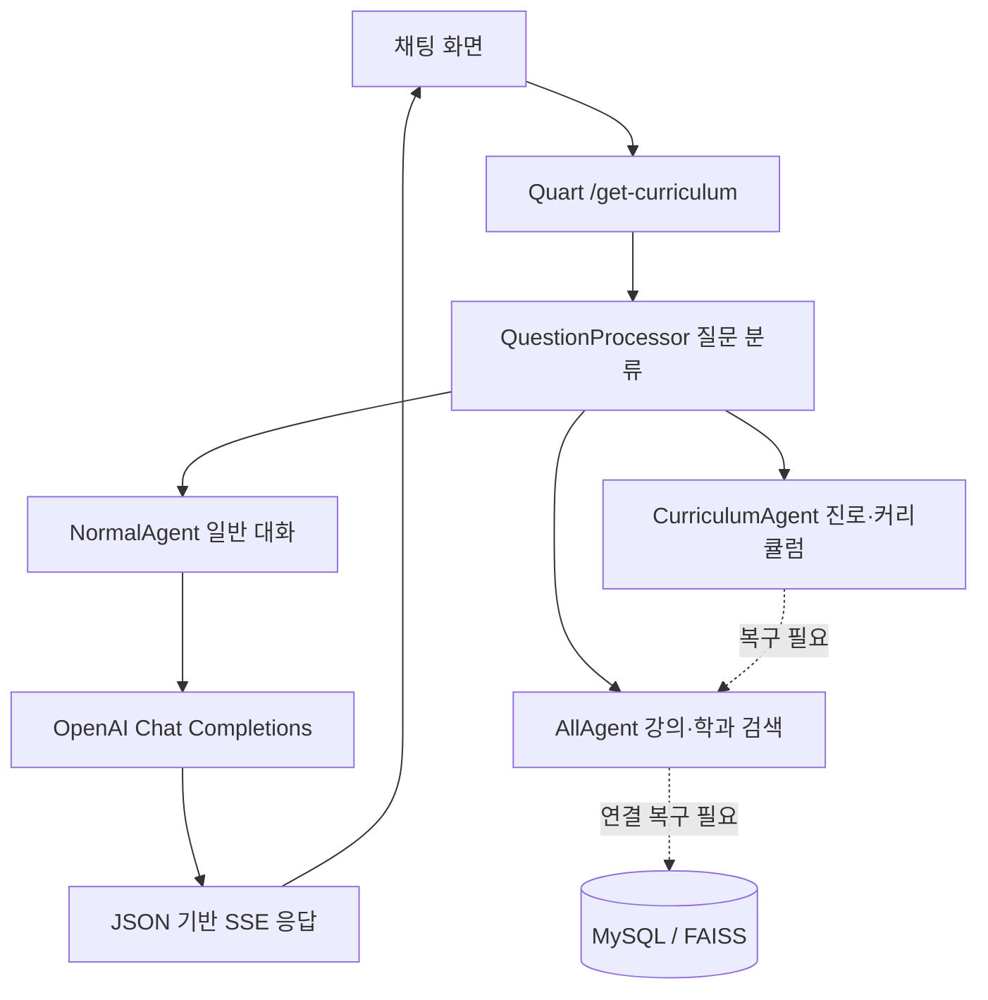

# AImentor

**대학 강의 정보와 학생의 진로 목표를 연결하는 대화형 학습·커리큘럼 추천 프로젝트**

전북대학교를 대상으로 만들었던 AI 멘토 프로토타입입니다. 학생의 질문을 분류하고, 학과·강의 정보 검색과 진로 기반 커리큘럼 추천을 하나의 채팅 화면으로 연결하는 구조를 담고 있습니다.

> **현재 상태: 소스 복구 및 공개용 정리본**
>
> 남아 있던 ZIP에서 소스를 복구했습니다. 웹 화면과 일반 채팅 경로는 실행 가능하도록 정리했지만, **원본의 학과·강의 검색 구현이 누락되어 있어 실제 커리큘럼 추천은 아직 사용할 수 없습니다.** OpenAI API와 실제 DB를 연결한 종단 간 검증은 수행하지 않았습니다. [복구 기록](docs/RECOVERY.md)과 [보완 계획](docs/ROADMAP.md)을 확인해 주세요.

## 프로젝트가 다루는 문제

학생은 진로에 맞는 과목을 선택하기 위해 학과별 강의계획, 수업목표, 개설 학기, 선수과목 정보를 따로 찾아야 합니다. AImentor는 자연어 질문에서 진로와 필요한 기술을 파악하고, 강의 정보를 근거로 학기별 학습 경로를 제안하려는 프로젝트입니다.

원래 의도한 질문 예시:

- “컴퓨터공학부의 커리큘럼을 알려줘.”
- “선형대수학은 어떤 교수님이 가르치나요?”
- “AI를 활용한 배터리 전문가가 되려면 어떤 과목을 들어야 해?”

위 검색·추천 질문은 현재 복구본에서 기능 복구 안내를 반환합니다. 일반 대화는 API 키를 설정한 뒤 사용할 수 있습니다.



화면 확인을 위해 **모의 응답**을 사용한 예시입니다. 실제 모델의 추천 결과가 아닙니다.

## 기능과 현재 상태

| 기능 | 역할 | 현재 상태 |
| --- | --- | --- |
| 채팅 UI | 질문 입력, 응답 표시, 테마 변경 | 실행 및 화면 확인 |
| 대화 기록 | 최근 5개 질문·답변을 브라우저에 저장 | 구현됨 |
| 질문 분류 | 일반 대화 / 강의 조회 / 진로 추천 / 학과 커리큘럼 구분 | 코드 보존, 모의 API 테스트 통과 |
| 일반 대화 | OpenAI Chat Completions 응답 스트리밍 | 모의 API 테스트 통과, 실제 API 미검증 |
| 강의·학과 조회 | DB 및 검색 인덱스에서 근거 수집 | `AllAgent` 구현 복구 필요 |
| 학과 추천 | 진로·핵심 기술에 맞는 학과 검색 | 구현 복구 필요 |
| 학기별 추천 | 과목 중복과 선수과목을 고려한 추천 | 알고리즘 소스 보존, 데이터 연동·정확성 검증 필요 |
| 과목 상세 UI | 선택한 과목의 학과와 수업목표 표시 | JSON 이벤트 처리 구현, 실제 추천 연동 미검증 |

대화 기록은 브라우저 `localStorage`에 저장되며, 후속 질문의 문맥으로 서버에 전달됩니다. 화면의 삭제 버튼으로 기록을 지울 수 있습니다.

## 처리 구조



점선은 현재 복구본에 연결 구현이 없는 부분입니다. 검색 결과를 임의로 만들어 응답하는 대신, 해당 기능이 복구되지 않았다는 안내를 표시합니다.

## 기술 구성

| 구분 | 구성 |
| --- | --- |
| 언어 | Python, JavaScript |
| 웹 서버 | Quart |
| 생성 API | OpenAI SDK `0.28.1`, Chat Completions |
| 원본 모델 설정 | 일반 응답 `gpt-4o-mini`, 학기별 추천 `gpt-4o` |
| 데이터 연결 | MySQL Connector, 요청별 지연 연결 |
| 선택적 검색 도구 | FAISS, Sentence Transformers, NumPy |
| 화면 | HTML, CSS, JavaScript, SSE |

API 호출 방식은 원본과의 호환성을 위해 구버전 SDK 형식을 유지했습니다. 현재 SDK로의 이관과 비동기 API 호출은 [보완 계획](docs/ROADMAP.md)에 정리했습니다. 모델 접근 권한과 사용 가능 여부는 사용하는 OpenAI 계정에 따라 확인해야 합니다.

## 시작하기

검증 환경은 **Python 3.12 / Windows**입니다. 다른 운영체제와 Python 버전은 별도 검증하지 않았습니다.

### 1. 설치

PowerShell 기준:

```powershell
git clone https://github.com/hno130/ai_mentor.git
cd ai_mentor
py -3.12 -m venv .venv
.\.venv\Scripts\python.exe -m pip install -r requirements-lock.txt
Copy-Item .env.example .env
```

`requirements-lock.txt`는 검증에 사용한 전체 버전 목록이며, `requirements.txt`는 직접 사용하는 패키지의 버전 범위입니다.

### 2. 환경변수 설정

`.env`의 `OPENAI_API_KEY`에 본인의 키를 입력합니다. `.env`는 Git에서 제외되어 있습니다.

| 변수 | 기본값 / 용도 |
| --- | --- |
| `OPENAI_API_KEY` | 기본값 없음. 일반 대화 및 질문 분류에 필요 |
| `OPENAI_CHAT_MODEL` | `gpt-4o-mini` |
| `OPENAI_CURRICULUM_MODEL` | `gpt-4o` |
| `APP_HOST` / `APP_PORT` | `127.0.0.1` / `8080` |
| `MYSQL_HOST` / `MYSQL_PORT` | `127.0.0.1` / `3306` |
| `MYSQL_USER` / `MYSQL_PASSWORD` | `ai_mentor` / 기본 비밀번호 없음 |
| `MYSQL_DATABASE` | `ai_mentor` |
| `DATA_DIR` | 저장소의 `data/` 폴더. 외부 데이터 경로 지정 가능 |

일반 채팅과 화면 로딩에는 MySQL 연결이 필요하지 않습니다. DB 설정은 검색 기능을 복구한 뒤 사용합니다. API 호출에는 사용하는 계정의 요금이 발생할 수 있습니다.

### 3. 실행

저장소 최상위 폴더에서 실행합니다.

```powershell
.\.venv\Scripts\python.exe Agent/main.py
```

브라우저에서 **http://127.0.0.1:8080**을 엽니다. API 키 없이도 첫 화면과 `/health` 확인은 가능합니다.

검색 관련 패키지는 복구 작업이 필요한 경우에만 추가로 설치합니다.

```powershell
.\.venv\Scripts\python.exe -m pip install -r requirements-search.txt
```

검색 패키지를 설치해도 누락된 검색 기능이 자동으로 복구되지는 않습니다.

## 폴더 구성

```text
ai_mentor/
├─ Agent/
│  ├─ main.py                  # 웹 서버와 스트리밍 응답
│  ├─ config.py                # 환경변수 기반 설정
│  ├─ Agent.py                 # 공통 응답 생성
│  ├─ NormalAgent.py           # 일반 대화
│  ├─ AllAgent.py              # 누락된 검색 기능의 명시적 복구 지점
│  ├─ QuestionProcessor.py     # 질문 분류와 에이전트 배정
│  ├─ CurriculumAgent.py       # 원본 커리큘럼 추천 알고리즘
│  ├─ DatabaseConnection.py    # 요청별 MySQL 연결
│  ├─ setting.py               # 선택적 임베딩 유틸리티
│  ├─ static/                 # 스타일, 채팅 스크립트, 이미지
│  └─ templates/index.html     # 채팅 화면
├─ data/examples/              # 실제 데이터가 아닌 가상 구조 예시
├─ docs/                       # 복구 기록과 보완 계획
├─ tests/                      # 외부 API를 호출하지 않는 회귀 테스트
├─ .env.example
├─ requirements.txt
├─ requirements-lock.txt
└─ requirements-search.txt
```

## API와 스트리밍 형식

| 경로 | 설명 |
| --- | --- |
| `GET /` | 채팅 화면 |
| `GET /health` | 서버 상태와 검색 기능 사용 가능 여부 |
| `GET /get-curriculum?question=...&history=...` | 질문 처리 및 SSE 응답 |

질문은 1~2,000자이며, `history`는 `question`과 `response` 문자열을 가진 배열입니다. 최근 5개 항목을 사용합니다.

SSE는 `text`, `courses`, `status`, `error`, `done` 이벤트와 JSON 데이터를 사용합니다. 줄바꿈·공백과 교과목 배열을 문자열 정규식으로 재해석하지 않습니다.

```text
event: text
data: "안녕하세요.\n다음 문장입니다."

event: done
data: {}
```

클라이언트는 `done` 또는 오류를 받으면 연결을 닫습니다. 현재 GET 방식은 복구본의 호환성을 위한 것으로, 배포 단계에서는 질문·대화 기록을 POST 요청 본문으로 옮기는 작업이 필요합니다.

## 검증

```powershell
.\.venv\Scripts\python.exe -m unittest discover -s tests -v
```

외부 API와 DB 없이 수행하는 회귀 테스트 10개를 통과했습니다. 화면·상태 경로, 입력 검증, 키 누락 처리, 모의 일반 대화, 검색 기능 안내, SSE 공백·JSON 처리, 요청별 연결 분리 및 종료를 확인합니다.

이 검증은 실제 모델 응답의 품질, 실제 MySQL 연결, 검색 정확도, 선수과목 제약의 만족 여부를 보장하지 않습니다.

## 다음 작업

1. **검색 기능 복구:** `AllAgent` 원본 구현을 찾거나, 문서화한 데이터 구조를 기준으로 재구현합니다.
2. **데이터 재현성 확보:** DB 스키마·적재 과정·인덱스 생성 과정을 코드로 만듭니다.
3. **추천 결과 검증:** 과목 식별자, 개설 학기, 선수과목, 학점 제한을 코드로 검증합니다.
4. **API 및 배포 정리:** 현재 SDK의 비동기 클라이언트, POST 스트리밍, 사용자별 요청 제한을 도입합니다.

구체적인 이유와 완료 기준은 [보완 계획](docs/ROADMAP.md)에 있습니다.

## 데이터와 원본 기록

원본 주소는 [mono130/ai_mentor](https://github.com/mono130/ai_mentor)였으나, 복구 시점에는 공개 접근으로 확인할 수 없었습니다. 이 저장소는 남아 있던 다운로드 ZIP에서 복구한 새 공개본이며, 원래 Git 커밋 기록은 포함되지 않습니다.

원본 DB·스프레드시트·검색 인덱스·캐시·개인 연결 설정은 공개본에서 제외했습니다. [데이터 안내](data/README.md)에 필요한 데이터 형식과 복구 절차를 적었습니다. 원본의 라이선스 파일은 발견되지 않아 별도의 이용허락을 임의로 추가하지 않았습니다.
